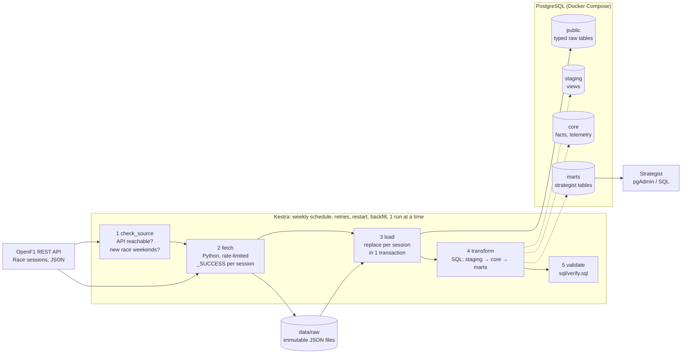

# F1 Race Strategy & Overtaking Analytics - End-to-End Batch Pipeline

DENG HS26 - Florian Item & Florian Leimer

A batch pipeline that loads Formula 1 race data from the [OpenF1 API](https://openf1.org/docs/)
into PostgreSQL and turns it into tables a race strategist can query: which strategies
work at a circuit, how fast tyres degrade, what a pit stop costs, how likely a Safety Car
is and how hard it is to overtake. Kestra runs it every Monday after a race weekend.

**Contents**

1. [Quick start: run it on your laptop](#1-quick-start-run-it-on-your-laptop)
2. [Verify the result](#2-verify-the-result)
3. [Troubleshooting](#3-troubleshooting)
4. [Use case and user](#4-use-case-and-user)
5. [Data source](#5-data-source)
6. [Pipeline steps](#6-pipeline-steps)
7. [Data models (transformation)](#7-data-models-transformation)
8. [Orchestration, reruns and backfills](#8-orchestration-reruns-and-backfills)
9. [Architecture v0.2](#9-architecture-v02)
10. [Repository structure](#10-repository-structure)
11. [Limitations](#11-limitations)

---

## 1. Quick start: run it on your laptop

You only need **Docker Desktop** (or Docker Engine with Compose v2) and **git**. No
Python or anything else on your laptop: every step runs in a container.

| Before you start | |
|---|---|
| Free disk space | **at least 25 GB** for the full history (2023 until today): about 13 GB raw JSON + 7 GB database |
| Time of the first run | **about 2.5 hours** (about 1.5 min per race weekend, 92 race weekends as of October 2026). Later runs only fetch the new race (2 min). |
| Free ports | `8080` (Kestra) and `8085` (pgAdmin), see [Troubleshooting](#3-troubleshooting) |
| Docker Desktop | **started and running** for the whole time; keep the laptop awake during the first run |

All commands run **in the repository folder**. They are the same on macOS, Linux and
Windows PowerShell, unless a step says otherwise.

### Step 1: clone the repository

```sh
git clone <repo-url> DENG
cd DENG
```

### Step 2: create your `.env`

```sh
cp .env.example .env
```

(Windows PowerShell: `Copy-Item .env.example .env`)

Open `.env` in an editor. **One value must be changed: `HOST_DATA_DIR`**, the absolute
path of the repo's `data/` folder. Find it with:

| OS | Command (run in the repo folder) | Example result |
|---|---|---|
| macOS / Linux | `mkdir -p data && echo "$PWD/data"` | `/Users/anna/DENG/data` |
| Windows PowerShell | `mkdir -Force data; (Resolve-Path data).Path.Replace('\', '/')` | `C:/Users/anna/DENG/data` |

Paste the result into `.env`, e.g. `HOST_DATA_DIR=/Users/anna/DENG/data`.

The passwords in `.env.example` work as they are. Change them if you like (the Kestra
password needs 8+ characters with an upper-case letter, a lower-case letter and a digit).
Never commit `.env`; git ignores it.

### Step 3: check the configuration

```sh
docker compose config --quiet
```

**Expected:** no output. An error like `required variable HOST_DATA_DIR is missing a
value` names the line in `.env` to fix.

### Step 4: build the pipeline image and start the services

```sh
docker compose build code
docker compose up -d --wait
```

The first command builds `deng-f1-code:local`, the image that contains the pipeline
scripts (Kestra starts every task from it). The second starts PostgreSQL, pgAdmin,
Kestra, Kestra's own database, and imports the flow into Kestra. It takes 1-2 minutes.

**Expected:** the last lines all say `Healthy`, e.g.

```text
 ✔ Container deng-kestra-1          Healthy
 ✔ Container deng-kestra-flows-1    Healthy
```

### Step 5: run the pipeline in Kestra

1. Open **http://localhost:8080** and log in with `KESTRA_USER` / `KESTRA_PASSWORD` from
   your `.env` (default: `student@example.com` / `Change-me-Kestra1`).
2. Left menu **Flows** → click **`f1_race_weekend`** (namespace `deng.f1`).
3. Click **Execute** (top right). Keep the defaults (`since` = `2023-01-01`, `force` = off)
   and click **Execute** again.
4. Open the **Gantt** tab to see the five tasks and the **Logs** tab to follow progress.
   `fetch` is the long one: it prints one line per downloaded file.

**Expected:** after about 2.5 hours all five tasks are green and the execution state is
**SUCCESS**:

```text
check_source → fetch → load → transform → validate
```

> **In a hurry?** Execute with `since` = `2026-10-01` instead. That loads only the last
> two race weekends (about 5 minutes), enough to check that everything works. You can run
> the full history later; already downloaded races are skipped.

**If the first run is interrupted** (laptop asleep, Docker restarted, Wi-Fi gone): start
Docker again, run `docker compose up -d --wait`, open the failed execution in Kestra and
click **Restart**, or just execute the flow again. Nothing is downloaded or loaded twice.

From now on, Kestra runs the flow **every Monday at 06:00** (Zurich time) and loads the
race weekend of the past week, as long as Docker is running.

### Stop and start again

```sh
docker compose stop        # stop everything, keep all data
docker compose up -d --wait  # start again
docker compose down -v     # delete everything incl. the database (data/raw stays)
```

---

## 2. Verify the result

### 2.1 Kestra

The execution of `f1_race_weekend` is **SUCCESS** and all five tasks are green. The
`validate` task's log ends with `11 of 11 checks passed`.

### 2.2 Run the checks yourself

```sh
docker compose run --rm code scripts/validate.py
```

**Expected output:**

```text
PASS  every fetched session (_SUCCESS) is loaded
PASS  raw laps: one row per (session, driver, lap)
PASS  raw stints: one row per (session, driver, stint)
PASS  raw pit: one row per (session, driver, lap)
PASS  every loaded race has a result and a starting grid
PASS  every loaded race is in core.fct_lap
PASS  telemetry is up to date for every loaded race
PASS  stint compound is a known value
PASS  tyre age is never negative
PASS  every lap is assigned to a stint (max 1 percent missing)
PASS  every mart has rows
11 of 11 checks passed
```

The SQL checks are in [`sql/verify.sql`](sql/verify.sql); you can also paste that file
into pgAdmin.

### 2.3 Query the data

Open a SQL prompt (replace `f1` if you changed `POSTGRES_USER` / `POSTGRES_DB` in `.env`):

```sh
docker compose exec postgres psql -U f1 -d f1
```

Or use **pgAdmin** at **http://localhost:8085** (log in with `PGADMIN_DEFAULT_EMAIL` /
`PGADMIN_DEFAULT_PASSWORD`), then **Servers → Register → Server**: name `F1`, tab
*Connection*: host `postgres`, port `5432`, database/user/password from your `.env`.

**Reference race: 2026 Singapore Grand Prix** (`session_key = 11388`). These numbers are
the same on every machine:

```sql
SELECT 'laps' AS table_name, count(*) FROM public.laps WHERE session_key = 11388
UNION ALL SELECT 'stints', count(*) FROM public.stints WHERE session_key = 11388
UNION ALL SELECT 'pit', count(*) FROM public.pit WHERE session_key = 11388
UNION ALL SELECT 'intervals', count(*) FROM public.intervals WHERE session_key = 11388
UNION ALL SELECT 'car_data', count(*) FROM public.car_data WHERE session_key = 11388;
```

| table_name | count |
|---|---|
| laps | 1240 |
| stints | 47 |
| pit | 25 |
| intervals | 28131 |
| car_data | 799898 |

What does a pit stop cost in Singapore, and how hard is it to overtake there?

```sql
SELECT circuit_short_name, season, n_green_stops, median_pit_loss_s, median_first_stop_lap
FROM marts.mart_pit_loss WHERE circuit_short_name = 'Singapore';

SELECT circuit_short_name, season, avg_on_track_passes, grid_finish_correlation
FROM marts.mart_overtaking_difficulty WHERE circuit_short_name = 'Singapore';
```

| circuit_short_name | season | n_green_stops | median_pit_loss_s | median_first_stop_lap |
|---|---|---|---|---|
| Singapore | 2026 | 21 | 24.1 | 29.5 |

| circuit_short_name | season | avg_on_track_passes | grid_finish_correlation |
|---|---|---|---|
| Singapore | 2026 | 28.0 | 0.75 |

With the full history loaded, the same queries also return rows for 2023-2025.

---

## 3. Troubleshooting

| Problem | Cause and fix |
|---|---|
| `required variable HOST_DATA_DIR is missing a value` (or another variable) | `.env` is missing or incomplete. Run step 2 again and compare with `.env.example`. |
| `Bind for 127.0.0.1:8080 failed: port is already allocated` (or `8085`) | Another program or Docker stack uses the port, e.g. the course's Week 5 Kestra. Stop it (`docker ps` shows which container, then `docker stop <name>`), or set `KESTRA_PORT=8081` / `PGADMIN_PORT=8086` in `.env` and open that port instead. |
| `Cannot connect to the Docker daemon` / `docker: command not found` | Docker Desktop is not running. Start it and wait until it says *running*. |
| http://localhost:8080 does not load | Kestra needs about 30 s after starting. Check `docker compose ps`: `deng-kestra-1` must be `healthy`. If the containers are gone (Docker restarted), run `docker compose up -d --wait`. |
| Kestra login fails | Use exactly `KESTRA_USER` / `KESTRA_PASSWORD` from your `.env`. If you changed them after the first start, run `docker compose up -d --wait` again. |
| Flow `f1_race_weekend` is not listed in Kestra | Re-import it: `docker compose restart kestra-flows`, then reload the page. |
| A task fails with `No such image: deng-f1-code:local` | Step 4 was skipped: run `docker compose build code`. |
| A task fails with a mount error, or the flow succeeds but the repo's `data/raw` stays empty | `HOST_DATA_DIR` in `.env` is wrong (Docker then creates that folder elsewhere and stores the files there). It must be the absolute path of the repo's `data/` folder, with `/` (also on Windows). Fix it, run `docker compose up -d --wait`, and execute the flow again. |
| `check_source` fails with `OpenF1 access denied: Live F1 session in progress` | OpenF1 blocks everything while an F1 session is live. Kestra retries for about 35 minutes; otherwise Restart the execution after the session has ended. |
| `fetch` fails with `N sessions failed, re-run to resume` | The API was overloaded or offline. Kestra already retried 4 times. Restart the execution later; finished sessions are skipped. |
| `validate` fails | A data check failed (the log says which). The data stays in the database for investigation. Please open an issue with the log. |
| `no space left on device` | The full history needs about 20 GB. Free disk space (or increase Docker Desktop's disk limit under *Settings → Resources*), then Restart the execution. |

---

## 4. Use case and user

**User / stakeholder:** an F1 team's race strategist (or a strategy-focused fan
analyst) who prepares the next race weekend and reviews the last one.

**Problem:** raw lap-by-lap and telemetry data is too granular and too large to reason
about directly. The strategist needs curated tables, filterable by **circuit** (what to
expect at the next race) and **season** (trends), that answer:

1. How does each tyre compound degrade over a stint, and from which tyre age does a pit
   stop pay off?
2. How hard is it to overtake at this circuit, and how much did grid position, race pace
   and strategy decide the result?
3. How likely is a Safety Car (a cheap pit stop), and when?

**Data product:** the marts in schema `marts` (see [Data models](#7-data-models-transformation)),
built on lap-, stint- and pit-stop-level fact tables in schema `core`.

## 5. Data source

- **Source:** [OpenF1 API](https://openf1.org/docs/), a free, unofficial, community-run
  REST API for Formula 1 data (not affiliated with the F1 companies). JSON over HTTP GET,
  no authentication for historical data (2023 season onward).
- **Live-session lock:** while any F1 session is live, OpenF1 denies **all** requests
  without a paid key (HTTP 401), including historical data. The pipeline therefore runs
  on Monday morning, and `check_source` fails early (and retries) if it is locked.
- **Sessions used:** only the **Race** session of each race weekend. Qualifying only
  enters through `starting_grid`; practice and sprint sessions are not used.
- **Endpoints used:** `meetings`, `sessions` (find the race and its `session_key`),
  `drivers`, `laps`, `stints`, `pit`, `position`, `intervals`, `race_control`, `weather`,
  `session_result`, `starting_grid` (fetched from the qualifying session) and `car_data`
  (telemetry, about 3.7 Hz per car, fetched per driver because a whole race at once is
  rejected with HTTP 422).
- **Not used:** `location` (very large, no clear use), `overtakes` (live only),
  `team_radio` (coverage dropped in 2026).
- **Volume:** most endpoints have tens to a few thousand rows per race; `intervals` about
  28,000; `car_data` about 800,000 rows (about 150 MB of JSON) per race.
- **Update behaviour:** a new race appears after each race weekend. Finished races were
  checked to be static: the 2026 Singapore race fetched 3 and 6 days after the race gave
  byte-identical files for all 32 endpoints/drivers.
- **Known data-quality issues** (handled in the staging views):
  - `throttle` goes up to 104 (about 10 % of samples), `brake` is 0/100/104.
  - `gap_to_leader` / `interval` are seconds or text like `+1 LAP`.
  - OpenF1 labels Sprints `session_type = 'Race'`; `session_name` is used instead.
  - `pit_duration` is deprecated (always equals `lane_duration`); `stop_duration` only
    exists from the 2024 US GP on.
  - one stint has no compound; 66 laps have no `lap_duration`.
  - `drs` is empty in 2026 (new regulations without DRS).

## 6. Pipeline steps

One flow, five tasks. Each task runs one script from [`scripts/`](scripts) in its own
container from the project image; the logic lives in [`src/`](src).

| # | Task | Script | What it does | Fails when | Retry |
|---|---|---|---|---|---|
| 1 | `check_source` | `check_source.py --since DATE` | Asks OpenF1 for finished race weekends since `DATE` and lists them | API down or locked by a live session | yes |
| 2 | `fetch` | `fetch.py --since DATE [--force]` | Downloads every endpoint of each Race into `data/raw/<year>/<meeting>/<session>/`, unchanged JSON | any session incomplete | yes |
| 3 | `load` | `load.py` | Loads every complete session into typed tables in schema `public` | wrong type, unknown field, row-count mismatch | no |
| 4 | `transform` | `transform.py [--full-refresh]` | Rebuilds the `staging`, `core` and `marts` models from [`sql/transform/`](sql/transform) | SQL error, duplicate key on a model's grain | no |
| 5 | `validate` | `validate.py` | Runs the checks in [`sql/verify.sql`](sql/verify.sql) plus raw-files-vs-database | any check fails | no |

Only the two network tasks retry (exponential, 5 min → 1 h, 4 attempts). The other three
fail for permanent reasons (bad data, bad SQL), where a retry would only repeat the
failure.

**Fail fast:** if `fetch` cannot complete every session, the run stops there and nothing
is loaded. A rerun skips everything that is already complete.

### 6.1 Fetch (ingestion)

- Throttled to 3 requests/second and 30/minute (`pyrate-limiter`), retried with
  exponential backoff on 422, 429, 5xx and timeouts (`tenacity`).
- A session folder gets a `_SUCCESS` marker (timestamp + row count per file) only after
  all its endpoints were downloaded. Files are written to a temporary name first and then
  renamed, so an interruption never leaves a half-written file.
- An empty response where data is expected counts as a failure (no `_SUCCESS`).
- A week without a race is not an error: `check_source` and `fetch` report "0 race
  weekends" and exit successfully; the later steps then have nothing new to do.

### 6.2 Load (storage)

- Schema-on-write: one table per endpoint in schema `public` with one typed column per
  API field ([`sql/schema.sql`](sql/schema.sql)). A new, renamed or wrongly typed field
  fails the session's load instead of slipping through.
- **One transaction per session:** delete the session's rows, insert them again, compare
  every table's row count with `_SUCCESS`. On any error the session is rolled back and
  its earlier rows stay.
- **Incremental:** `public.loaded_sessions` records which `_SUCCESS` marker each session
  was loaded from; only new or re-fetched sessions are loaded.

### 6.3 Transform and validate

See [Data models](#7-data-models-transformation). The transform runs all files in
`sql/transform/` in name order **in one transaction**: until it commits, queries see the
previous version of every model.

### 6.4 Running a step without Kestra

Every task can also be run by hand (handy for development):

```sh
docker compose run --rm code scripts/check_source.py --since 2026-10-01
docker compose run --rm code scripts/fetch.py --since 2026-10-01
docker compose run --rm code scripts/load.py
docker compose run --rm code scripts/transform.py
docker compose run --rm code scripts/validate.py
```

After changing Python code or SQL files, rebuild the image (`docker compose build code`)
so that Kestra and `docker compose run` use the new version.

## 7. Data models (transformation)

ELT: the data is loaded unchanged first, then transformed with SQL inside PostgreSQL.

```text
public.*  (raw, typed)  →  staging (views)  →  core (facts)  →  marts (for the strategist)
```

| Layer | Materialization | Why |
|---|---|---|
| `staging` | plain views | renaming, typing and cleaning only; no copy of the data |
| `core` | materialized views with a unique index on the grain; `fct_lap_telemetry` is an incremental table | the unique index makes a build with duplicate rows fail; telemetry is the only large input (about 0.8M rows per race) and is only recomputed for new or reloaded races |
| `marts` | materialized views with a unique index on the grain | small, pre-aggregated, fast to query |

Views and materialized views are dropped and rebuilt on every run, so a rerun always
gives the same result and a changed definition is picked up automatically.

### 7.1 Core models (schema `core`)

| Model | Grain | Content |
|---|---|---|
| `fct_neutralisation` | one Safety Car / VSC / red-flag period | start/end lap and time, from race control messages |
| `fct_lap` | (session, driver, lap) | lap time, compound, tyre age, pit in/out, neutralised, weather, fuel-corrected lap time, `is_clean_lap` |
| `fct_lap_position` | (session, driver, lap) | position at the end of each lap |
| `fct_lap_telemetry` | (session, driver, lap) | top speed, slow-corner speed (10th percentile), % full throttle, braking events, lift-and-coast seconds |
| `fct_stint` | (session, driver, stint) | compound, length, clean laps, degradation (s/lap), grip loss (km/h/lap) |
| `fct_pit_stop` | (session, driver, in-lap) | lane time, stationary time, under neutralisation, compounds before/after, pit loss |
| `fct_race_result` | (session, driver) | grid, finish, positions gained, number of stops, strategy (e.g. `M-H`) |
| `fct_on_track_pass` | (session, lap, passing driver, passed driver) | position swaps under green flag, without pit laps |
| `fct_undercut_attempt` | (session, driver, lap) | car directly behind pits first, the car ahead pits 1-3 laps later; success if ahead afterwards |

**Cleaning rules (and why):**

- `is_clean_lap`: not lap 1, no pit in/out lap, no Safety Car/VSC/red flag, no rain, and
  faster than 107 % of the driver's median green lap. Only these laps show real tyre
  pace; the others are dominated by the start, pit lane, neutralisation or traffic.
- Fuel correction: `lap_duration - (total_laps - lap_number) * 0.035 s`. A car gets
  faster as fuel burns off, which would hide tyre degradation.
- Degradation per stint = slope of fuel-corrected lap time over tyre age (clean laps
  only, at least 5). Marts use the **median of stint slopes**, so every driver is only
  compared with themselves.

### 7.2 Marts (schema `marts`)

| Mart | Grain | Strategist question |
|---|---|---|
| `mart_strategy_per_circuit` | circuit, season, strategy | Which strategies were run here and how many positions did they gain? |
| `mart_safety_car_risk` | circuit (all seasons) | How likely is a Safety Car/VSC/red flag, and from which lap? |
| `mart_pit_loss` | circuit, season | What does a green-flag stop cost, and when is the first stop? |
| `mart_overtaking_difficulty` | circuit, season | How many on-track passes, and how strongly does the grid decide the result? |
| `mart_tyre_degradation` | circuit, season, compound | How many seconds per lap does each compound lose? |
| `mart_pit_window` | circuit, season, compound | From which tyre age does a stop pay off? (`sqrt(2 * pit_loss / deg)`) |
| `mart_undercut` | circuit, season | How often does the undercut work here? |
| `mart_team_tyre_management` | season, team, compound | Which teams degrade less than the field, and who lifts and coasts? |
| `mart_weather_effect` | season, compound, track temperature band | Does a hotter track increase degradation? |
| `mart_grip_loss` | circuit, season, compound, tyre age | How much slow-corner speed and lap time does a tyre lose with age (telemetry)? |
| `mart_circuit_character` | circuit, season | Full throttle %, braking events, top speed: why is a circuit hard on tyres? |

Example, "preparing the next race at Singapore":

```sql
SELECT * FROM marts.mart_strategy_per_circuit WHERE circuit_short_name = 'Singapore' ORDER BY season, n_drivers DESC;
SELECT * FROM marts.mart_pit_window          WHERE circuit_short_name = 'Singapore' ORDER BY season, compound;
SELECT * FROM marts.mart_safety_car_risk     WHERE circuit_short_name = 'Singapore';
```

## 8. Orchestration, reruns and backfills

Kestra ([`orchestration/flows/f1_race_weekend.yaml`](orchestration/flows/f1_race_weekend.yaml))
only schedules, orders, retries and shows the steps. **Idempotency lives in the scripts**,
so every way of running the flow again is safe:

| Situation | What to do | Why it is safe |
|---|---|---|
| Weekly run | nothing: schedule `0 6 * * 1` (Monday 06:00, Europe/Zurich), looks back 8 days from the scheduled date | the weekend's race is finished, and no session is live on Monday morning |
| A task failed | open the execution → **Restart** (continues at the failed task) | finished sessions are skipped, each session is replaced in one transaction |
| Missed Mondays (Docker was off) | **Triggers** tab → `monday_after_race_weekend` → **Backfill executions** with a date range | each backfill run uses its own scheduled date, not today |
| Full history or a specific period | **Execute** with `since` = e.g. `2023-01-01` | same flow, already loaded races are skipped |
| Re-download a race (suspected bad data) | **Execute** with `force` = on | new `_SUCCESS` marker → the session is reloaded |
| Two runs at once | they queue (`concurrency: limit 1`) | they never write the same files or rows at the same time |

The flow file is imported automatically by the `kestra-flows` service on
`docker compose up`. After editing it, run `docker compose restart kestra-flows`.

## 9. Architecture v0.2

Changes since v0.1:
- The orchestrator is Kestra, not asset-based.
- The steps are separate tasks, with a source check before them and validation after.
- The transformation is plain SQL in PostgreSQL, not dbt.
- Telemetry is aggregated incrementally.



**Runtime (Docker Compose, project `deng`, network `deng_default`):**

| Service | Purpose |
|---|---|
| `postgres` | project database (the F1 data) |
| `pgadmin` | browser UI for the database, http://localhost:8085 |
| `kestra` | orchestrator UI and scheduler, http://localhost:8080; starts each task as a container through the Docker socket |
| `kestra-postgres` | Kestra's own metadata (flows, executions, logs), separate from the F1 data |
| `kestra-flows` | imports `orchestration/flows/*.yaml` into Kestra on start-up |
| `code` | the pipeline image `deng-f1-code:local`, used for Kestra's tasks and for `docker compose run` |

`postgres`, `kestra-postgres` and `kestra` restart automatically with Docker
(`restart: unless-stopped`), so the Monday schedule survives a Docker restart.

**Final project (outlook):** the same steps load into BigQuery instead of PostgreSQL
(`--raw-dir gs://…` is already supported by the fetch and load steps), provisioned with
Terraform.

Security note: Kestra has access to the Docker socket so it can start task containers.
That is fine for a local single-user setup, but anyone who can edit flows can control
Docker. All ports are bound to `127.0.0.1`.

## 10. Repository structure

```text
├── README.md
├── docker-compose.yml        services (see Architecture)
├── Dockerfile                pipeline image deng-f1-code:local
├── .env.example              configuration template, copy to .env
├── pyproject.toml, uv.lock   Python dependencies (installed in the image with uv)
├── orchestration/
│   ├── application.yaml      Kestra server configuration (mounted into the kestra container)
│   └── flows/                Kestra flow f1_race_weekend.yaml
├── scripts/                  one entry point per pipeline step
├── src/                      fetch.py, load.py, transform.py, validate.py
├── sql/
│   ├── schema.sql            raw tables (load step)
│   ├── transform/            staging, core and mart models, run in name order
│   └── verify.sql            data checks (validate step)
└── data/raw/                 downloaded JSON (gitignored)
```

## 11. Limitations

- OpenF1 is unofficial, community-run, has no SLA and a 3 requests/second limit; it is
  completely unavailable during live F1 sessions.
- Fuel effect of 0.035 s/lap is an assumption, not measured. Track evolution (the track
  getting faster during a race) is not corrected.
- SOFT/MEDIUM/HARD are relative per race (Pirelli picks three of its compounds); they are
  only comparable within one circuit and season. The 2026 regulation change means
  2023-2025 degradation does not transfer 1:1 to 2026.
- Laps are matched to Safety Car periods by the leader's lap number, and telemetry
  samples to laps by timestamp (from the start of one lap to the start of the next).
- On-track passes are derived from lap-end positions: a car that passes and is passed
  back within the same lap is not counted.
- The pit-window rule ignores traffic, track position and the next stint's degradation.
- With one race per circuit and season, many marts rest on small samples; the sample
  size is always included (`n_stints`, `n_laps`, `n_races`, ...).
- Materialized views are fully rebuilt on every run (simple and idempotent, cheap at
  this size); only telemetry is incremental.
