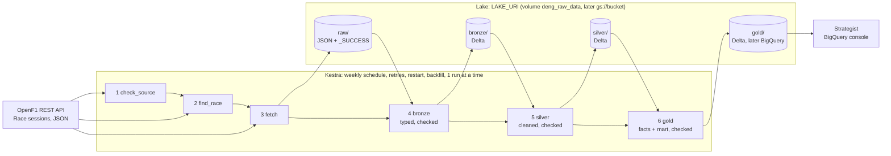

# F1 Race Strategy & Overtaking Analytics - End-to-End Batch Pipeline

DENG HS26 - Florian Item & Florian Leimer

A batch pipeline that loads Formula 1 race data from the [OpenF1 API](https://openf1.org/docs/)
into a Spark + Delta Lake medallion lakehouse (raw → bronze → silver → gold) and answers
one question for a race strategist: **how do tyre and pit strategy and on-track position
changes decide race outcomes?** Every driver's result is split into the positions won or
lost at the start, on track, in the pits and otherwise. Kestra runs it every Monday after
a race weekend.

> **Status (v1.0 in progress):** the lake runs locally in the Docker volume
> `deng_raw_data` (`LAKE_URI=/app/data`). Moving it to Google Cloud Storage, and gold to
> BigQuery, waits for the course's GCP access; the Terraform for it is in
> [`terraform/`](terraform). v0.2 (PostgreSQL) is tag `v0.2.0`.

**Contents**

1. [Quick start: run it on your laptop](#1-quick-start-run-it-on-your-laptop)
2. [Verify the result](#2-verify-the-result)
3. [Troubleshooting](#3-troubleshooting)
4. [Use case and user](#4-use-case-and-user)
5. [Data source](#5-data-source)
6. [Pipeline steps](#6-pipeline-steps)
7. [Data models (transformation)](#7-data-models-transformation)
8. [Orchestration, reruns and backfills](#8-orchestration-reruns-and-backfills)
9. [Architecture v1.0](#9-architecture-v10)
10. [Evolution: what v1.0 fixes in v0.2](#10-evolution-what-v10-fixes-in-v02)
11. [Cloud setup (Terraform)](#11-cloud-setup-terraform)
12. [Repository structure](#12-repository-structure)
13. [Limitations](#13-limitations)

---

## 1. Quick start: run it on your laptop

You only need **Docker Desktop** (or Docker Engine with Compose v2) and **git**. No
Python or anything else on your laptop: every step runs in a container.

| Before you start      |                                                                                                                                        |
|-----------------------|----------------------------------------------------------------------------------------------------------------------------------------|
| Free disk space       | **at least 15 GB** for the full history (2023 until today): about 11.5 GB raw JSON + 0.8 GB Delta tables                                  |
| Memory                | Docker Desktop with **at least 8 GB** (each task runs Spark with a 6 GB driver)                                                         |
| Time of the first run | **about 8 hours** (about 5 min per race weekend, 92 race weekends as of October 2026). Later runs only add the new race (5 min). |
| Free port             | `8080` (Kestra), see [Troubleshooting](#3-troubleshooting)                                                                               |
| Docker Desktop        | **started and running** for the whole time, keep the laptop awake during the first run                                                  |

All commands run **in the repository folder**. They are the same on macOS, Linux and
Windows PowerShell, unless a step says otherwise.

### Step 1: clone the repository

```sh
git clone https://github.com/FloHoliday/DENG.git
cd DENG
```

### Step 2: create your `.env`

```sh
cp .env.example .env
```

(Windows PowerShell: `Copy-Item .env.example .env`)

`.env` works as it is: nothing has to be changed. The passwords in `.env.example` work as they are. Change them if you
like (the Kestra
password needs 8+ characters with an upper-case letter, a lower-case letter and a digit).
Never commit `.env`, git ignores it.

### Step 3: check the configuration

```sh
docker compose config --quiet
```

**Expected:** no output. An error like `required variable KESTRA_PASSWORD is missing a
value` names the line in `.env` to fix.

### Step 4: build the pipeline image and start the services

```sh
docker compose build code
docker volume create deng_raw_data
docker compose up -d --wait
```

The first command builds `deng-f1-code:local`, the image that contains the pipeline
scripts, Java and Spark with the Delta Lake jars (Kestra starts every task from it; the
build ends with a Spark smoke test). The second creates the volume for the lake: the
downloaded raw JSON and the Delta tables (safe to repeat: an existing volume is kept as
it is). The third starts Kestra and Kestra's own database. Kestra loads the flow from
`orchestration/flows/` by itself. It takes 1-2 minutes.

**Expected:** the last lines all say `Healthy`, e.g.

```text
 ✔ Container deng-kestra-1          Healthy
```

### Step 5: run the pipeline in Kestra

1. Open **http://localhost:8080** and log in with `KESTRA_USER` / `KESTRA_PASSWORD` from
   your `.env` (default: `student@example.com` / `Change-me-Kestra1`).
2. Left menu **Flows** → click **`f1_race_weekend`** (namespace `deng.f1`).
3. Open the **Triggers** tab → `monday_after_race_weekend` → **Backfill executions**.
   Set the start to `2023-01-01`, leave the end and the date input empty, and click **Execute backfill**. Kestra creates
   one
   execution per Monday. Each loads the race of the week before it (if any), one at a time.
4. Open an execution's **Gantt** tab to see the tasks and the **Logs** tab to follow
   progress. `fetch` is the long one: it prints one line per downloaded file.

**Expected:** after about 8 hours every execution is **SUCCESS**. Race weeks run all
six tasks, weeks without a race stop green after `find_race`:

```text
check_source → find_race → fetch → bronze → silver → gold
```

> **In a hurry?** Click **Execute** instead and leave `date` empty (or set it to the Monday
> after a race). That loads one race weekend (about 5 minutes), enough to check that
> everything works. You can backfill the full history later, downloaded races are skipped.

**If a run is interrupted** (laptop asleep, Docker restarted, Wi-Fi gone): start
Docker again, run `docker compose up -d --wait`, open the failed execution in Kestra and
click **Restart**, or just execute the flow again. Nothing is downloaded or loaded twice.

From now on, Kestra runs the flow **every Monday at 06:00** (Zurich time) and loads the
race weekend of the past week, as long as Docker is running.

### Stop and start again

```sh
docker compose stop        # stop everything, keep all data
docker compose up -d --wait  # start again
docker compose down -v     # delete Kestra's executions and logs, the lake stays
docker volume rm deng_raw_data  # also delete the lake: raw files and Delta tables
```

---

## 2. Verify the result

### 2.1 Kestra

The execution of `f1_race_weekend` is **SUCCESS** and all six tasks are green. The
logs of `bronze`, `silver` and `gold` show one `PASS`/`WARN`/`FAIL` line per check and
race; a `FAIL` stops that race from being published and fails the task. `silver` and
`gold` also fail if the race of the run's meeting is not built afterwards (for example
when `fetch` found nothing to write).

### 2.2 Run the checks yourself

```sh
docker compose run --rm code scripts/silver.py
docker compose run --rm code scripts/gold.py
```

**Expected output** when nothing changed since the last run:

```text
gold: 0 races to build
gold: 0 races built, 0 failed
```

Every race whose input changed, or that failed before, is rebuilt and checked first;
the command exits with an error if one fails.

### 2.3 Query the data

The gold tables are in the BigQuery dataset `gold` of the GCP project
(`terraform output gold_dataset`). Open the [BigQuery console](https://console.cloud.google.com/bigquery),
select the project and run the queries below in a new SQL tab. The dataset appears in
the explorer on the left, where every table has its schema and a row preview.

**Reference race: 2026 Singapore Grand Prix** (`session_key = 11388`). These numbers are
the same on every machine:

```sql
SELECT 'fct_lap' AS table_name, count(*) AS row_count
FROM gold.fct_lap
WHERE session_key = 11388
UNION ALL
SELECT 'fct_stint', count(*)
FROM gold.fct_stint
WHERE session_key = 11388
UNION ALL
SELECT 'fct_pit_stop', count(*)
FROM gold.fct_pit_stop
WHERE session_key = 11388
UNION ALL
SELECT 'fct_lap_telemetry', count(*)
FROM gold.fct_lap_telemetry
WHERE session_key = 11388
UNION ALL
SELECT 'mart_race_outcome', count(*)
FROM gold.mart_race_outcome
WHERE session_key = 11388
```

| table_name        | row_count |
|-------------------|-----------|
| fct_lap           | 1240      |
| fct_stint         | 47        |
| fct_pit_stop      | 25        |
| fct_lap_telemetry | 1236      |
| mart_race_outcome | 22        |

Where were positions won and lost in Singapore? Sum of positions moved per cause, over
all classified finishers:

```sql
SELECT circuit_short_name,
       season,
       sum(abs(gained_lap1))     AS moved_lap1,
       sum(abs(gained_on_track)) AS moved_on_track,
       sum(abs(gained_in_pits))  AS moved_in_pits,
       sum(abs(gained_other))    AS moved_other
FROM gold.mart_race_outcome
WHERE circuit_short_name = 'Singapore'
GROUP BY circuit_short_name, season
```

| circuit_short_name | season | moved_lap1 | moved_on_track | moved_in_pits | moved_other |
|--------------------|--------|------------|----------------|---------------|-------------|
| Singapore          | 2026   | 22         | 40             | 11            | 10          |

With the full history loaded, the same query also returns 2023 (20, 29, 35, 39),
2024 (16, 27, 44, 0) and 2025 (20, 34, 40, 2).

### 2.4 Look at the raw files

The raw JSON is stored in the Docker volume `deng_raw_data`, not in the repo folder (a
volume works the same on macOS, Linux and Windows). List or copy it with:

```sh
# list the files of 2026
docker compose run --rm --entrypoint ls code -R data/raw/2026
# copy everything into the folder raw-copy/ (rarely needed)
docker run --rm -v deng_raw_data:/from -v "$PWD/raw-copy:/to" deng-f1-code:local -c "import shutil; shutil.copytree('/from', '/to', dirs_exist_ok=True)"
```

---

## 3. Troubleshooting

| Problem                                                                        | Cause and fix                                                                                                                                                                                                                                 |
|--------------------------------------------------------------------------------|-----------------------------------------------------------------------------------------------------------------------------------------------------------------------------------------------------------------------------------------------|
| `required variable KESTRA_PASSWORD is missing a value` (or another variable)   | `.env` is missing or incomplete. Run step 2 again and compare with `.env.example`.                                                                                                                                                            |
| `Bind for 127.0.0.1:8080 failed: port is already allocated`                    | Another program or Docker stack uses the port, e.g. the course's Week 5 Kestra. Stop it (`docker ps` shows which container, then `docker stop <name>`), or set `KESTRA_PORT=8081` in `.env` and open that port instead.                       |
| A Spark task fails with `Java heap space` or exit code 137                     | Docker Desktop has too little memory. Give it at least 8 GB under *Settings → Resources*, then Restart the execution.                                                                                                                         |
| `silver` or `gold` fails with `N races failed`                                 | A race failed its build or its checks (the `FAIL` line names the check); it published nothing, all other races were built. Fix the cause, then Restart: failed races are retried.                                                            |
| `Cannot connect to the Docker daemon` / `docker: command not found`            | Docker Desktop is not running. Start it and wait until it says *running*.                                                                                                                                                                     |
| http://localhost:8080 does not load                                            | Kestra needs about 30 s after starting. Check `docker compose ps`: `deng-kestra-1` must be `healthy`. If the containers are gone (Docker restarted), run `docker compose up -d --wait`.                                                       |
| Kestra login fails                                                             | Use exactly `KESTRA_USER` / `KESTRA_PASSWORD` from your `.env`. If you changed them after the first start, run `docker compose up -d --wait` again.                                                                                           |
| Flow `f1_race_weekend` is not listed in Kestra                                 | Kestra syncs it from `orchestration/flows/` on start-up. Run `docker compose restart kestra`, wait until healthy, reload the page. The file name must start with `main_` (Kestra takes the tenant from it).                                   |
| A task fails with `No such image: deng-f1-code:local`                          | Step 4 was skipped: run `docker compose build code`.                                                                                                                                                                                          |
| `check_source` fails with `OpenF1 access denied: Live F1 session in progress`  | OpenF1 blocks everything while an F1 session is live. Kestra retries for about 2 h 45 min (15, 30, 60, 60 min). Otherwise restart the execution manually after the session has ended.                                                         |
| `fetch` fails with `N sessions failed, re-run to resume`                       | The API was overloaded or offline. Kestra already tried 4 times. Restart the execution later, finished sessions are skipped.                                                                                                                  |
| `silver` or `gold` fails with `the race of meeting KEY is not built`           | `fetch` or `bronze` wrote nothing for that race, or it failed in an earlier stage (the log says which). Please open an issue with the log.                                                                                                     |
| `no space left on device`                                                      | The full history needs about 15 GB. Free disk space (or increase Docker Desktop's disk limit under *Settings → Resources*), then Restart the execution.                                                                                       |

---

## 4. Use case and user

**User / stakeholder:** an F1 team's race strategist (or a strategy-focused fan
analyst) who prepares the next race weekend and reviews the last one.

**Problem:** raw lap-by-lap and telemetry data is too granular and too large to reason
about directly. The strategist needs curated tables, filterable by **circuit** (what to
expect at the next race) and **season** (trends), that answer the question from the pitch:

> How do tyre and pit strategy and on-track position changes actually decide race outcomes?

**Data product:** `mart_race_outcome` in gold, one row per driver per race (see
[Data models](#7-data-models-transformation)), built on lap-, stint-, pit-stop- and
result-level fact tables, also in gold. The core tables (one row per driver per lap,
stint, stop or race) also serve a possible ML use case.

## 5. Data source

- **Source:** [OpenF1 API](https://openf1.org/docs/), a free, unofficial, community-run
  REST API for Formula 1 data (not affiliated with the F1 companies). JSON over HTTP GET,
  no authentication for historical data (2023 season onward).
- **Live-session lock:** while any F1 session is live, OpenF1 denies **all** requests
  without a paid key (HTTP 401), including historical data. The pipeline therefore runs
  on Monday morning, and `check_source` fails early (and retries) if it is locked.
- **Sessions used:** only the **Race** session of each race weekend. Qualifying only
  enters through `starting_grid`. Practice and sprint sessions are not used.
- **Endpoints used:** `meetings`, `sessions` (find the race and its `session_key`),
  `drivers`, `laps`, `stints`, `pit`, `position`, `intervals`, `race_control`, `weather`,
  `session_result`, `starting_grid` (fetched from the qualifying session) and `car_data`
  (telemetry, about 3.7 Hz per car, fetched per driver because a whole race at once is
  rejected with HTTP 422).
- **Not used:** `location` (very large, no clear use), `overtakes` (live only),
  `team_radio` (coverage dropped in 2026).
- **Volume:** most endpoints have tens to a few thousand rows per race. `intervals` about
  28,000, `car_data` about 800,000 rows (about 150 MB of JSON) per race.
- **Update behaviour:** a new race appears after each race weekend. Most finished races
  stay the same (the 2026 Singapore race fetched 3 and 6 days later was byte-identical),
  but not all: re-fetching 2026 Bahrain on 20 Nov 2026 showed corrected `stints` (tyre
  ages) and `pit` (`stop_duration` filled in). The pipeline does not pick these up yet
  (see [Limitations](#13-limitations)).
- **Known data-quality issues** (handled in silver):
    - `throttle` goes up to 104 (about 10 % of samples), `brake` is 0/100/104.
    - `gap_to_leader` / `interval` are seconds or text like `+1 LAP`.
    - OpenF1 labels Sprints `session_type = 'Race'`, `session_name` is used instead.
    - `pit_duration` is deprecated (always equals `lane_duration`). `stop_duration` only
      exists from the 2024 US GP on.
    - one stint has no compound, 66 laps have no `lap_duration`.
    - `drs` is empty in 2026 (new regulations without DRS).
    - `n_gear` has glitches from 9 up to 200+ (about 1 in 10,000 samples in some races),
      set to NULL.

## 6. Pipeline steps

One flow, six tasks. Each task runs one script from [`scripts/`](scripts) in its own
container from the project image. The logic lives in the package [`src/deng_f1/`](src/deng_f1). `LAKE_URI` (default
`data`, in Kestra `/app/data`) is the root of the lake: `raw/`, `bronze/`, `silver/`,
`gold/`.

| # | Task           | Script                                            | What it does                                                                                                                  | Fails when                                         | Retry |
|---|----------------|---------------------------------------------------|-------------------------------------------------------------------------------------------------------------------------------|----------------------------------------------------|-------|
| 1 | `check_source` | `check_source.py`                                 | Sends one tiny request to check that OpenF1 answers                                                                           | API down or locked by a live session               | yes   |
| 2 | `find_race`    | `find_race.py [--date DATE]`                      | Asks OpenF1 for the finished Race in the 7 days before `DATE` and outputs its `meeting_key` to Kestra                         | more than one race found                           | no    |
| 3 | `fetch`        | `fetch.py --meeting-key KEY`                      | Downloads every endpoint of that weekend's Race into `raw/<year>/<meeting>/<session>/` as JSON                                | any session incomplete                             | yes   |
| 4 | `bronze`       | `bronze.py --meeting-key KEY`                     | Checks every new session and loads it into typed Delta tables                                                                 | a session fails (type, unknown field, check)       | no    |
| 5 | `silver`       | `silver.py --meeting-key KEY`                     | Cleans and conforms that weekend's race if its bronze data changed ([`sql/silver/`](sql/silver))                              | the race fails its build or checks, or is missing  | no    |
| 6 | `gold`         | `gold.py --meeting-key KEY`                       | Builds the facts and the mart of that weekend's race if its silver data changed ([`sql/gold/`](sql/gold))                     | the race fails its build or checks, or is missing  | no    |

Only `check_source` (exponential, 15 min → 1 h, 5 attempts) and `fetch` (5 min → 1 h,
4 attempts) are retried by Kestra. `find_race` runs right after a successful
`check_source`, so it only retries its HTTP request (`tenacity`). The other four
fail for permanent reasons (bad data, bad SQL), where a retry would only repeat the
failure.

**Write → audit → publish:** bronze, silver and gold check each race's data *before*
writing it. A failed `error` check publishes nothing for that race, so a reader never sees
it; a `warn` check is only logged. All checks print in one format, e.g.
`PASS  gold 9165: fct_lap: one row per (session_key, driver_number, lap_number)`.

| Stage  | Checks (error = blocks the race, warn = logged)                                                                                                                                                                               |
|--------|-------------------------------------------------------------------------------------------------------------------------------------------------------------------------------------------------------------------------------|
| bronze | rows = `_SUCCESS` counts · one row per key: laps, stints, pit · race has a result and a starting grid · compound in the known set · warn: drivers outside 18–22, grid shorter than the driver list                                |
| silver | speed 0–400, `throttle_pct` 0–100, `n_gear` 0–8, tyre age ≥ 0 · every gap is seconds or `+N LAP(S)` · warn: timestamps more than 2 h outside the race, `n_gear` glitches set to NULL                                           |
| gold   | one row per key in every table · every race has laps, telemetry, stints, results and the mart · ≤ 5 % of laps without a stint (warn > 1 %) · tyre age ≥ 0 · served penalties matched to a pit record · outcome split adds up |

**Fail fast:** if `fetch` cannot complete every session, the run stops there and nothing
is loaded. A rerun skips everything that is already complete.

### 6.1 Fetch (ingestion)

- Throttled to 3 requests/second and 30/minute (`pyrate-limiter`), retried with
  exponential backoff on 422, 429, 5xx and timeouts (`tenacity`).
- A session folder gets a `_SUCCESS` marker (timestamp + row count per file) only after
  all its endpoints were downloaded. Files are written to a temporary name first and then
  renamed, so an interruption never leaves a half-written file.
- An empty response where data is expected counts as a failure (no `_SUCCESS`).
- A week without a race is not an error: `find_race` outputs `meeting_key: null`
  and the execution ends successfully without running the later steps.

### 6.2 Bronze (storage)

- Schema-on-write: one Delta table per endpoint in `bronze/` with one typed column per
  API field ([`src/deng_f1/bronze.py`](src/deng_f1/bronze.py)). A new, renamed or wrongly typed field
  fails the session instead of slipping through.
- **Per session:** read the files, run the bronze checks, then replace only that
  session's rows (`replaceWhere session_key = …`, one Delta commit per table). Other races
  are never touched.
- **Incremental:** `bronze/built_sessions` records when each session was loaded; a session
  is loaded again only if its `_SUCCESS` is newer. It is written last, so a session that
  fails half-way is loaded again.
- **Scoped:** Kestra passes the `meeting_key` to bronze, silver and gold.
  Without `--meeting-key`, `bronze.py` scans all of `raw/`, e.g. to catch up.
- No partitioning: one Parquet file per race and table (a race's `car_data` is about
  3 MB, from about 150 MB of JSON), found through Delta's min/max statistics.

### 6.3 Silver and gold (transformation)

See [Data models](#7-data-models-transformation). Both work **per race**:
`<stage>/built_sessions` records when each race was last built successfully. A race is
rebuilt if the stage before built it more recently (bronze for silver, silver for gold)
or if it has no row yet. A race that fails writes no row, so the next run retries it. Each race runs every SQL file of the stage in name order, is checked as a whole
and then replaces its rows in every table. Readers see the previous version until then.
With `--meeting-key`, only that meeting's race is considered, and the step fails if it
is not built afterwards. Without it, every changed or failed race is built, e.g. to retry
an old race after a fix. `--full-refresh` deletes the stage and rebuilds all races
(needed after changing the SQL).

### 6.4 Running a step without Kestra

Every task can also be run by hand (handy for development):

```sh
docker compose run --rm code scripts/check_source.py
docker compose run --rm code scripts/find_race.py --date 2026-10-13  # prints the meeting_key
docker compose run --rm code scripts/fetch.py --meeting-key <meeting_key>
docker compose run --rm code scripts/bronze.py --meeting-key <meeting_key>  # omit: all of raw/
docker compose run --rm code scripts/silver.py --meeting-key <meeting_key>  # omit: every changed race
docker compose run --rm code scripts/gold.py --meeting-key <meeting_key>  # omit: every changed race
docker compose run --rm code scripts/smoke_spark.py  # Spark + Delta work in the image
```

After changing Python code or SQL files, rebuild the image (`docker compose build code`)
so that Kestra and `docker compose run` use the new version.

## 7. Data models (transformation)

ELT on a medallion lakehouse: the data is stored as received first, then typed, cleaned
and modelled with Spark SQL, one race at a time.

```text
raw (JSON files)  →  bronze (typed)  →  silver (cleaned)  →  gold (facts + mart, for the strategist)
```

| Layer    | Format                         | Content                                                                                       |
|----------|--------------------------------|-----------------------------------------------------------------------------------------------|
| `raw`    | JSON files + `_SUCCESS`        | the API responses, unchanged                                                                  |
| `bronze` | Delta tables, one per endpoint | one typed column per API field, schema enforced on write                                      |
| `silver` | Delta tables, one per endpoint | renaming, typing and cleaning only, no joins ([`sql/silver/`](sql/silver))                    |
| `gold`   | Delta tables                   | the facts and the mart ([`sql/gold/`](sql/gold)); moves to BigQuery once GCP is available    |

Delta Lake adds ACID commits, schema enforcement and time travel on top of Parquet:
`replaceWhere` swaps one race's rows in one commit, and `DESCRIBE HISTORY` shows every
write. Delta does not enforce primary keys, so each stage checks the grain itself.

### 7.1 Facts (gold)

| Model                  | Grain                                         | Content                                                                                                               |
|------------------------|-----------------------------------------------|-----------------------------------------------------------------------------------------------------------------------|
| `fct_neutralisation`   | one Safety Car / VSC / red-flag period        | start/end lap and time, from race control messages                                                                    |
| `fct_lap`              | (session, driver, lap)                        | lap time, compound, tyre age, pit in/out, neutralised, weather, fuel-corrected lap time, `is_clean_lap`               |
| `fct_lap_position`     | (session, driver, lap)                        | position at the end of each lap (order of crossing the line, unique per lap)                                          |
| `fct_lap_telemetry`    | (session, driver, lap)                        | top speed, slow-corner speed (10th percentile), % full throttle, braking events, lift-and-coast seconds               |
| `fct_stint`            | (session, driver, stint)                      | compound, length, clean laps, degradation (s/lap), grip loss (km/h/lap)                                               |
| `fct_pit_stop`         | (session, driver, in-lap)                     | lane time, stationary time, under neutralisation, red flag, penalty, `is_real_stop`, compounds before/after, pit loss |
| `fct_race_result`      | (session, driver)                             | grid, finish, positions gained, number of stops, strategy (e.g. `M-H`)                                                |
| `fct_position_swap`    | (session, lap, gaining driver, losing driver) | every swap of two cars from one lap end to the next, with its cause: `on_track`, `pit` or `neutralised`               |
| `fct_undercut_attempt` | (session, driver, lap)                        | car directly behind pits first, the car ahead pits 1-3 laps later. Success if ahead afterwards                        |

**Cleaning rules (and why):**

- `is_clean_lap`: not lap 1, no pit in/out lap, no Safety Car/VSC/red flag, no rain, and
  faster than 107 % of the driver's median green lap. Only these laps show real tyre
  pace. The others are dominated by the start, pit lane, neutralisation or traffic.
  The 107 % threshold is borrowed from F1's [107% rule](https://en.wikipedia.org/wiki/107%25_rule).
- Fuel correction: `lap_duration - 0.03 s/kg * 100 kg * (total_laps - lap_number) / total_laps`,
  i.e. 0.03 s per kg of remaining fuel, 100 kg at the start, the same amount burned every
  lap. A car gets faster as fuel burns off, which would hide tyre degradation. Sources:
  [Michelin Simulation, "Showing our sensitive side" (2018)](https://simulation.michelin.com/canopy/technical-articles/showing-our-sensitive-side)
  (0.03 s per additional kg) and [TracingInsights](https://github.com/TracingInsights/2026)
  (same formula with 100 kg and linear burn).
- Fake pit stops: not every pit record is a stop. `is_red_flag` marks cars waiting in the
  pit lane during a red flag (20 to 40 min lane time), `is_penalty` a drive-through or
  stop-and-go, matched by race control's "PENALTY SERVED" message. Stop numbers, pit loss
  and undercuts only use `is_real_stop`. The stint data is not used for this: OpenF1 also
  starts a new stint after a penalty or red flag and misses some real stops.
- Degradation per stint = slope of fuel-corrected lap time over tyre age (clean laps
  only, at least 5), so every driver is only compared with themselves.

### 7.2 Mart (gold)

`mart_race_outcome`, grain (race, driver). It splits each driver's result,
`positions_gained = grid - finish`, into four parts that add up exactly (a gold check
blocks the race otherwise), positive = positions won:

| Column            | Positions won or lost ...                                                                                                       | Built from                                                                 |
|-------------------|---------------------------------------------------------------------------------------------------------------------------------|----------------------------------------------------------------------------|
| `gained_lap1`     | at the start and on lap 1 (grid vs. position after lap 1)                                                                       | `fct_race_result`, `fct_lap_position`                                      |
| `gained_on_track` | by green-flag overtakes, made minus suffered                                                                                    | `fct_position_swap` (`on_track`)                                           |
| `gained_in_pits`  | by pit stops: own stops cost places, rivals' stops give places                                                                  | `fct_position_swap` (`pit`)                                                |
| `gained_other`    | under Safety Car/VSC without a stop, when cars ahead retire, across laps missing in the source, and by penalties after the flag | `fct_position_swap` (`neutralised`), `fct_lap_position`, `fct_race_result` |

The split is filled for classified finishers with a grid position (DNF rows keep their
grid, strategy and stops, but no split). Next to it, what the driver did: `strategy`
(compound sequence, e.g. `S-M`), `n_stops` and `n_stops_under_neutralisation` (real stops
only), `green_pit_loss_s`, `avg_deg_s_per_lap`, `longest_stint`, `n_undercut_attempts`,
`n_undercut_successes`.

Example, "how was the Singapore 2026 result decided for the top 8?":

```sql
SELECT name_acronym,
       grid_position,
       finish_position,
       gained_lap1,
       gained_on_track,
       gained_in_pits,
       gained_other,
       strategy,
       n_stops
FROM gold.mart_race_outcome
WHERE circuit_short_name = 'Singapore'
  AND season = 2026
ORDER BY finish_position NULLS LAST LIMIT 8
```

## 8. Orchestration, reruns and backfills

Kestra ([`orchestration/flows/main_f1_race_weekend.yaml`](orchestration/flows/main_f1_race_weekend.yaml))
only schedules, orders, retries and shows the steps. **Idempotency lives in the scripts**,
so every way of running the flow again is safe:

| Situation                         | What to do                                                                                                          | Why it is safe                                                             |
|-----------------------------------|---------------------------------------------------------------------------------------------------------------------|----------------------------------------------------------------------------|
| Weekly run                        | nothing: schedule `0 6 * * 1` (Monday 06:00, Europe/Zurich), loads the race of the 7 days before the scheduled date | the weekend's race is finished, and no session is live on Monday morning   |
| A task failed                     | open the execution → **Restart** (continues at the failed task)                                                     | finished sessions and races are skipped, each race is replaced in one commit per table |
| Missed Mondays (Docker was off)   | **Triggers** tab → `monday_after_race_weekend` → **Backfill executions** with a date range                          | each backfill run uses its own scheduled date, not today                   |
| Full history or a specific period | **Backfill executions** from e.g. `2023-01-01`. One race: **Execute** with `date` = the Monday after it             | one race per execution, already loaded races are skipped                   |
| Two runs at once                  | they queue (`concurrency: limit 1`)                                                                                 | they never write the same files or rows at the same time                   |

Kestra watches `orchestration/flows/` (mounted to `/flows`, see
[`orchestration/application.yaml`](orchestration/application.yaml)): the flow is created on
start-up and updated within seconds whenever the file is saved. The file name must start
with `main_`, because Kestra 1.3 takes the tenant from the part before the first `_`.

## 9. Architecture v1.0

Changes since v0.2:

- PostgreSQL is gone (v0.2 stays available as tag `v0.2.0`). Storage is a medallion
  lakehouse: raw JSON files, then bronze, silver and gold Delta tables.
- Spark (PySpark 4.1, `local[*]`: driver and executors in one process per task) replaces
  SQL in PostgreSQL; the models are the same SQL, ported to Spark SQL.
- Every stage works per race and only on new or changed races, and checks a race before
  publishing it.



**Runtime (Docker Compose, project `deng`):**

| Service           | Purpose                                                                                                         |
|-------------------|-----------------------------------------------------------------------------------------------------------------|
| `kestra`          | orchestrator UI and scheduler, http://localhost:8080. Starts each task as a container through the Docker socket |
| `kestra-postgres` | Kestra's own metadata (flows, executions, logs)                                                                 |
| `code`            | the pipeline image `deng-f1-code:local` (Python, Java 21, Spark, Delta), for Kestra's tasks and `docker compose run` |

`kestra-postgres` and `kestra` restart automatically with Docker (`restart: unless-stopped`), so the Monday
schedule survives a Docker restart.

Security note: Kestra has access to the Docker socket so it can start task containers.
That is fine for a local single-user setup, but anyone who can edit flows can control
Docker. All ports are bound to `127.0.0.1`.

## 10. Evolution: what v1.0 fixes in v0.2

Problems we found in v0.2 (and verified) and how v1.0 fixes them:

| #  | Weakness of v0.2                                                                                                                                                                                                                                                                                                      | Fix in v1.0                                                                                                                                                                                                                          |
|----|-----------------------------------------------------------------------------------------------------------------------------------------------------------------------------------------------------------------------------------------------------------------------------------------------------------------------|--------------------------------------------------------------------------------------------------------------------------------------------------------------------------------------------------------------------------------------|
| W1 | **Validation only at the end.** `validate` ran after `transform` had committed, so a failed check left bad data already published to the strategist, and bronze problems surfaced only after the models were built on them.                                                                                         | Checks in every stage, run on a race's data **before** it is written (write → audit → publish), with severity error/warn and one report format.                                                                                     |
| W2 | **Models dropped and rebuilt on every run** (`DROP SCHEMA … CASCADE`): every run recomputed all races to add one, readers were blocked until the commit (the README claimed they saw the previous version), `CASCADE` silently deleted an analyst's view on the mart, and no run recorded what it rebuilt. | Persistent tables, updated **per race**: only races with a newer input are rebuilt (`replaceWhere`), readers keep the old version until the race's commit, each run logs the races it built, a definition change needs `--full-refresh`. |
| W4 | **One bad race blocked everything.** The transform built all races in one transaction: one duplicate key failed it, and because the bad race stayed in `raw`, every later run failed too.                                                                                                                         | Each race is built and checked on its own; a failed race publishes nothing and is retried in the next run, all other races are published. The run still ends red and names the race. A code bug still fails every race, as it should.   |

## 11. Cloud setup (Terraform)

[`terraform/`](terraform) describes the GCP resources: the lake bucket (object versioning
as a safety net for raw files, old versions deleted after 90 days), the BigQuery dataset
`gold`, and a service account with access to only that bucket and dataset (plus running
BigQuery jobs). Bucket and dataset are in `europe-west6` (Zurich). It is checked
(`terraform validate`) but not yet applied, because GCP access is still pending.

```sh
cd terraform
cp terraform.tfvars.example terraform.tfvars   # fill in project_id and bucket_name
terraform init && terraform apply
```

- **State:** local (`terraform.tfstate`, git-ignored). A remote backend would need a
  bucket before Terraform exists, and only one of us applies.
- **Credentials:** the service-account key is created by hand
  (`gcloud iam service-accounts keys create f1-pipeline-key.json --iam-account <service_account output>`),
  never by Terraform, so it is not in the state. It stays outside the repo (`*-key.json`
  is git-ignored) and is mounted into the task containers. Application Default
  Credentials (`gcloud auth application-default login`) work as well.
- **Moving the lake:** copy `raw/` from the volume to the bucket once (no API requests),
  then set `LAKE_URI` to the `lake_uri` output. The GCS and BigQuery connectors are added
  to the image in that step.

## 12. Repository structure

```text
├── README.md
├── docker-compose.yml        services (see Architecture)
├── Dockerfile                pipeline image deng-f1-code:local
├── .env.example              configuration template, copy to .env
├── pyproject.toml, uv.lock   Python dependencies (installed in the image with uv)
├── orchestration/
│   ├── application.yaml      Kestra server configuration (mounted into the kestra container)
│   └── flows/                Kestra flow main_f1_race_weekend.yaml
├── scripts/                  one entry point per pipeline step, plus smoke_spark.py
├── src/deng_f1/              fetch.py, bronze.py, silver.py, gold.py,
│                             stage.py (per-race build), checks.py, spark.py (session, LAKE_URI)
├── sql/
│   ├── silver/               one SELECT per silver table
│   └── gold/                 one SELECT per fact and the mart, run in name order
└── terraform/                GCP bucket, BigQuery dataset, service account
```

The lake is not in the repo folder: it lives in the Docker volume `deng_raw_data`
(see 2.4).

## 13. Limitations

- OpenF1 is unofficial, community-run, has no SLA and a 3 requests/second limit. It is
  completely unavailable during live F1 sessions.
- The fuel correction is a rule of thumb (0.03 s/kg, 100 kg, linear burn), not measured:
  the real fuel load and burn differ per car, circuit and fuel-saving, and the 2026 cars
  start with less fuel. Track evolution (the track getting faster during a race) is not
  corrected.
- SOFT/MEDIUM/HARD are relative per race (Pirelli picks three of its compounds). They are
  only comparable within one circuit and season. The 2026 regulation change means
  2023-2025 degradation does not transfer 1:1 to 2026.
- Laps are matched to Safety Car periods by the leader's lap number, and telemetry
  samples to laps by timestamp (from the start of one lap to the start of the next).
- Position changes are derived from lap-end positions: a car that passes and is passed
  back within the same lap is not counted, and a swap on a lap where one of the two cars
  pits counts as `pit`, even if it was a real overtake.
- A car that drives through the pit lane under Safety Car without changing tyres still
  counts as a real stop: OpenF1 has no tyre-change flag and its stint data is not
  reliable enough to detect it. Such stops are excluded from pit loss (neutralised), but
  not from stop counts.
- With one race per circuit and season, per-circuit conclusions rest on small samples. More seasons (2023-2025) make
  them more reliable.
- Spark is heavy for this data size (a race is about 1M rows): each task starts a JVM,
  so one race takes about 3.5 minutes instead of v0.2's 3 (fetch about 1 min, each Spark
  stage 30-60 s). It runs locally in one process (`local[*]`), not on a cluster.
- A fetched session is never fetched again, so a later OpenF1 correction (seen in 2026
  Bahrain: `stints` tyre ages, `pit` `stop_duration`) does not reach the mart. To pick it
  up, delete that session's folder in `raw/` and rerun the race: the new `_SUCCESS`
  makes every stage rebuild it.
- A race's tables are replaced one Delta commit per table, not in one transaction across
  tables. The bookmark is written last, so a race that fails half-way is rebuilt.
- The star-schema keys and the BigQuery partitioning/clustering follow after the
  modelling lecture; for now the facts use the natural keys and carry the driver's names.
