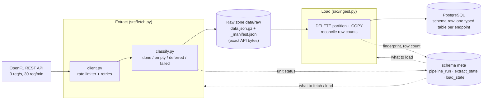

# Architecture

## Data flow of one run (`run`)

1. **Metadata refresh.** `meetings` and `sessions` are fetched for every year in scope. They are loaded right away, because discovery and the live-window guard read `raw.sessions`.
2. **Discovery** finds the eligible races: `session_name = 'Race'`, not cancelled, ended more than 30 min ago, in scope, matching the CLI filters. They are processed oldest first.
3. **Planning** builds the units per race. Units already `done`/`empty` are skipped unless the race is within `SETTLING_DAYS` or `--force` is given. Units that are `failed`/`deferred`/`pending` are planned again.
4. **Running.** `drivers` goes first, then the other session endpoints in registry order. After that, the `car_data` units are planned (one per driver from the stored `drivers` file) and run. Before each unit the live-window guard is checked, and so is the `--max-requests` limit.
5. **Load.** Every partition whose units are all `done`/`empty` and whose file fingerprint changed is replaced in one transaction.

## Grain

| Step | Grain | Key |
|---|---|---|
| Extract unit | one API request | `(endpoint, race_session_key, chunk_key)`; chunk `all`, or `driver=<n>` for `car_data` |
| Raw zone file | one unit | `openf1/v1/<endpoint>/year=/meeting_key=/session_key=/[driver_number=/]` |
| Load partition | all units of an endpoint for one race | `(endpoint, race_session_key)` |
| Raw table row | one API record | none guaranteed; lineage in `_race_session_key`, `_raw_path`, `_sha256`, `_run_id` |

For `meetings`/`sessions`, `race_session_key` holds the **year** (the
convention chosen in briefing §6.7).

`session_key` in the raw zone path is always the race key. This holds for
`starting_grid` too, which is queried with the qualifying key. The queried
key is recorded in the manifest (`queried_session_key`), and
`raw.starting_grid.session_key` keeps the value as returned.

## Failure handling

| Situation | Result |
|---|---|
| 429, 5xx, timeout, connection error | retried with backoff (or `Retry-After`), up to `MAX_RETRY_ATTEMPTS`, then `failed` |
| other 4xx (e.g. 422 "too much data") | `failed` at once, no retry |
| empty result (`200 []` or `404 "No results found."`) | `empty`; `deferred` if the race ended within `SETTLING_DAYS` |
| 401/403 during a live window | `deferred`; the run stops, remaining planned units `deferred`, exit 0 |
| 401/403 outside a live window | `failed` |
| crash / Ctrl+C mid-run | finished units are already committed; the current file write is atomic; rerun continues |
| raw file doesn't match its recorded sha256 | load raises, partition rolled back |
| inserted rows ≠ sum of manifest `record_count` | load raises, partition rolled back, previous rows kept |
| unknown API field | stored in `_extra` (jsonb), warning logged once |

Only `done`/`empty` responses are written to the raw zone. A failed re-fetch
therefore never overwrites a good earlier file.
